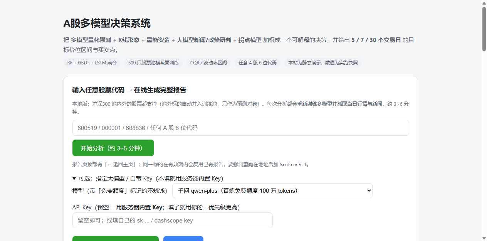

# stockpred · A 股多信号量化预测系统

[](https://dhysgf.github.io/stockpred-main/)
[](LICENSE)

用**真实公开行情 + 多模型集成 + 多信号联合决策**预测 A 股个股走势，并且**如实披露每一路信号到底有多少预测力**。

本项目的立场：不吹"AI 预测股价"。凡是无法验证的信号，都标明它是辅助；凡是实测无效的周期，代码里直接不给方向。

**在线演示**：<https://dhysgf.github.io/stockpred-main/>

> ⚠️ 仅供技术研究与学习，**不构成任何投资建议**。股市有风险，盈亏自负。

---

## 目录

- [它做什么](#它做什么)
- [实时分钟级跟踪（新增）](#实时分钟级跟踪新增)
- [涨幅榜爬虫（新增）](#涨幅榜爬虫新增)
- [在线演示](#在线演示)
- [部署边界：哪些能上 GitHub，哪些不能](#部署边界哪些能上-github哪些不能)
- [快速开始](#快速开始)
- [使用方式](#使用方式)
- [日线八路信号与联合决策](#日线八路信号与联合决策)
- [数据来源](#数据来源)
- [接入大模型（可选）](#接入大模型可选)
- [实测结果与统计口径](#实测结果与统计口径)
- [已知限制](#已知限制)
- [目录结构](#目录结构)
- [技术栈](#技术栈)

---

## 它做什么

输入一个 A 股代码，输出一份可读、可核查的分析：

| 模块 | 内容 |
|---|---|
| **价格 / 方向预测** | 未来 1/5/7/30 个交易日的目标收盘价 + 上涨概率 + 置信区间 |
| **目标价位与买卖点** | 分批建仓区、突破确认价、支撑/阻力、止盈减仓区、止损位（受风险预算封顶） |
| **K 线形态** | 19 类经典形态（吞没 / 锤子 / 星线 / 红三兵 / 缺口 / 突破…），带趋势上下文判方向 |
| **量能与买卖盘** | 量价配合、OBV、MFI、量能背离、主力资金分单净额、五档委比委差 |
| **新闻与政策** | 个股 / 政策 / 市场三类新闻，交大模型做结构化研判（情绪 + 政策影响） |
| **拐点预测** | 未来 5/10/20 个交易日内出现有效顶 / 底拐点的概率 + 预计拐点日区间 |
| **联合决策** | **日线**八路信号加权成 −1~1 综合分 → 买入 / 观望 / 卖出，**附每一路的权重与贡献**（实时层另有 14 路，见上表） |
| **回测** | walk-forward 样本外 MAE / MAPE / 方向准确率，可复现 |

三个设计原则：

1. **数字优先、文字在后**——先给结论和可执行价位，再给依据，最后才是原始信号表。
2. **不确定性显式表达**——目标价位给的是区间（带宽由模型分歧与波动率共同决定），不是单点承诺。
3. **无效的东西直说**——大样本检验中方向准确率接近随机的信号，权重降到辅助位；30 日周期直接不输出方向。

---

## 实时分钟级跟踪（新增）

启动方式（三选一）：

```bash
start_live.bat                     # Windows 双击即起（默认 8020，自动开浏览器）
python live.py --port 8020        # 轻量入口：只有实时跟踪 + 涨幅榜（零 pandas 依赖）
python web.py --port 8010         # 主入口：/live 与 /rank 已挂在同一服务里
```

打开 `http://127.0.0.1:8020/`（入口页，含市场状态与已入库数据概览），
或 `http://127.0.0.1:8020/live?code=600519`：

| 能力 | 说明 |
|---|---|
| **与行情刷新同频** | 每 3 秒拉一次新浪 hq 快照，预测随刷新实时更新（未来 1/3/5 分钟） |
| **十四路专家 + 在线加权** | 五档不平衡 / 主动买卖差 / **量价配合** / **K线能量** / **K线形态** / 区间突破 / 动量 / VWAP 回复 / 日内季节性 / 在线岭回归 / **日线模型** / **拐点风险** / 大模型 / **新闻政策面**；每路都按**已实现误差**做 Hedge 自适应降权，命中率与 MAE 全部落库可查。前两路对应日线的「买卖压力」；中间五路是日线 energy / pattern / volume 在分钟频率上的重算 |
| **区间而非单点** | 80% 覆盖区间 + 专家分歧收缩；幅度不足时明确输出「震荡」，不硬给方向 |
| **日内拐点** | 今日高/低点已出现概率、剩余时段极值价位与时间窗、下一局部拐点（几分钟 + 价位） |
| **每日对比** | 每条预测落库，到期用真实价结算 →「预测线 vs 真实价」叠加图 + 每日 1 日预测误差/命中率 |
| **大模型可选** | 页面上选供应商、填自己的 Key（只存本机 DB），按间隔限流参与加权（先验 6%、幅度封顶 ±40bps）；不填 Key 其余 13 路照常。页面上直接显示这一路的状态（等行情 / 调用中 / 失败原因），不再只写「未启用」 |
| **新闻政策面** | 个股+政策+市场新闻 → 本地词典情绪（无 Key 时）/ 大模型研判（有 Key 时）；**3 分钟低频刷新 + 30 分钟半衰期衰减 + 幅度封顶**，只给窄幅方向偏置，见下节 |
| **回放模式** | 非交易时段自动用最近交易日分钟线逐条推进，整条链路（结算/权重/统计）收盘后照样真实运转 |

诚实预期：5 分钟级别方向命中率的合理区间是 **50~55%**，单笔误差常大于预测幅度本身。
页面直接展示每路专家的真实命中率和 MAE——如果某一路长期 ≈50%，它会被 Hedge 自动降权。

数据库（SQLite，`data/stockpred.db`，WAL）：日线 / K线指标 / K线能量 / 决策与买卖点 /
多周期预测（自动回填真实收盘并算误差）/ 分钟线 / 实时预测与结算 / 专家状态 /
拐点 / 榜单快照 / 大模型配置与调用日志。CLI 同步：`python run.py --sync-db 600519`。

日线分析的决策层是**八路信号**：模型方向 / K线形态 / 量能资金 / **K线能量** /
**买卖压力** / 大模型新闻 / 大模型政策 / 拐点风险（权重见 `config.SIGNAL_WEIGHTS`）。
注意这 8 路与实时侧的 14 路专家**不是同一组**，对照见 [日线八路信号与联合决策](#日线八路信号与联合决策)。

### 实时侧的新闻 / 政策 / 舆论面（外生一路）

`stockpred/news_live.py`。和日线那套共用抓取与研判，但为分钟级做了三处改造：

| 改造 | 数值 | 为什么 |
|---|---|---|
| 低频刷新 | 180 秒 | 抓一次要 3~10 秒、LLM 要花钱，跟着 3 秒轮询跑不动 |
| 时间衰减 | 半衰期 30 分钟 | 半小时前的利好不该和刚出的利好同权 |
| 幅度封顶 | 5 分钟最多 0.35σ | 新闻对分钟级价格解释力弱，不许它抢盘口的发言权 |

产出 `score ∈ [-1,1] = 0.65×情绪 + 0.35×政策`，进 Hedge 时先验只有 **6%**，
再按实时结算误差自动升降。无 Key 时走本地词典情绪，来源会明确标成「词典情绪」而不是大模型结论。

**三点必须说明的局限**：
1. **无法回测** —— 没有历史新闻序列，这一路的权重没有样本外证据，只能靠小先验 + 在线学习；
2. **回放模式不参与加权** —— 新闻是"现在"的、分钟线是历史某天的，时间错配会污染误差统计，
   所以回放时只展示、不投票；
3. **LLM 端点连续失败会退避 10 分钟** —— 避免每 180 秒都去撞一次超时，期间自动用本地情绪。

---

## 涨幅榜爬虫（新增）

`http://127.0.0.1:8020/rank`：东方财富公开行情接口实时抓取**涨幅榜前 50**，
可切换 **A股（沪深全市场）/ 科创板**，含涨速、换手、量比、主力净流入，30 秒缓存 +
每分钟存一份历史快照（可回看「当时之前」的榜单；内容与上一份相同时只更新时间戳，不重复堆积）。
点击任意一行直达 `/live?code=xxx` 实时跟踪页——按提示输入大模型 Key（可选）即可开始跟踪该股价格。

**关于「刷新」**：页面上区分两个时间——`抓取`（本机什么时候拉的）和 `行情`（东财 `f124`，数据真实更新时间）。
收盘后东财榜单是冻结的，只有「行情」时间会说话，页面会亮出橙色提示条并自动把轮询降到 120 秒；
开盘后自动恢复 30 秒。所以「数字不动」在 15:00 之后是正常现象，不是页面卡住。

---

## 在线演示

👉 **<https://dhysgf.github.io/stockpred-main/>**（已通过 GitHub Pages 发布，源目录 `docs/`）

站点**只收录实时系统**，共三页，全部由本地引擎的真实运行结果固化而成：

- `docs/index.html` 落地页：系统定位、一次 tick 的链路、14 路专家清单、快照机制与部署边界
- `docs/live.html` 实时看板：当前预测 / 有效权重 / 各路贡献 / 历史命中率与 MAE、预测价 vs 到点真实价、今日结算与区间覆盖率
- `docs/rank.html` 涨幅榜爬虫：东方财富 A 股 / 科创板 Top50，点行直达对应标的看板

页面不放手工数字，由 `tools/build_live_snapshot.py`、`tools/build_rank_snapshot.py`
从 `data/stockpred.db` 直接生成，重新出页即可刷新。

> **日线多模型报告已从站点下线**（原 `report_*.html` / `analysis.html` / `news_snapshot.json`）。
> 那套系统代码仍在仓库里（`run.py` / `make_report.py` / `web.py`），
> 需要时本地跑 `python web.py` 或 `python run.py --code 600519` 生成，不再占用展示站。
> 历史报告原件仍留在 `examples/reports/`。

自行部署：仓库 **Settings → Pages → Source 选 `Deploy from a branch` → 分支 `main` / 目录 `/docs`**。

> 静态站没有后端：`/live`、`/rank`、`/report?code=XXX` 是本地版 `web.py` 的路由形态，Pages 上不存在。
> 改页面后跑一次 `python tools/check_docs_links.py`，它会拦下「站内绝对路径」与
> 「目标文件不存在」两类必然 404 的链接（Pages 项目站根是 `/<repo>/`，`href="/xxx"` 会绕过前缀）。

> 「Key 留空即用服务器内置 Key」只存在于**本地版** `python web.py`：它按浏览器会话隔离、
> 内存存放、不落盘。纯静态部署没有服务端，访客必须在页面里自己填 Key 才能跑新闻研判，
> 其余量化分析（价格 / 形态 / 量能 / 拐点 / 决策）不需要 Key。

---

## 部署边界：哪些能上 GitHub，哪些不能

GitHub 是代码托管 + 静态文件托管，**不是能跑长驻进程的主机**。所以本项目分两层：

| 能力 | 能否跑在 GitHub | 说明 |
|------|------------------|------|
| 静态展示站（报告 / 分析页 / 落地页） | ✅ GitHub Pages | 源目录 `docs/`，已启用：<https://dhysgf.github.io/stockpred-main/> |
| **实时分钟级跟踪**（`live.py`，每 3 秒拉行情、写 SQLite、Hedge 在线调权） | ❌ 不行 | 需要常驻进程 + 可写磁盘 + 持续外网访问行情源 |

**为什么实时层上不了 Pages**：Pages 只返回静态文件，没有可执行环境；实时页的每一个数字
（最新价、委比、9/14 路专家的即时预测、到期结算）都是后端每 3 秒现算的，
静态化之后就只剩一张过期快照。

**为什么上不了 Actions**：Actions 单次任务最长 6 小时、无持久磁盘、无固定入口，
且按用量计费。它适合做构建和测试，不适合做一个 7×24 的行情服务。

想在公网访问实时页，需要一台**常驻的机器**：

```bash
# 在任意有 Python 的机器 / VPS 上
pip install -r requirements.txt
python live.py --port 8020        # 打开 http://<该机IP>:8020/live?code=600519
```

若本机没有公网 IP，用内网穿透（frp / cloudflared / ngrok）把 8020 映射出去即可。
注意：**暴露公网前务必先看清 `data/stockpred.db` 里存着你的大模型 Key**，
它已在 `.gitignore` 中被排除，不会随仓库泄露，但服务本身对外可达时仍需加访问控制。

---

## 快速开始

```bash
git clone https://github.com/dhysgf/stockpred.git
cd stockpred

python -m venv .venv && source .venv/bin/activate   # Windows: .venv\Scripts\activate
pip install -r requirements.txt

python run.py --symbol 600519 --no-llm              # 先跑通量价链路（约 1~2 分钟）
```

依赖只有 `pandas / numpy / scikit-learn / matplotlib / snownlp`。
以下为可选增强，缺失时自动降级、不报错：

| 可选依赖 | 作用 |
|---|---|
| `torch` | LSTM 模型（`--model lstm` / `ensemble` 成员之一） |
| `xgboost` | GBDT 后端，缺失时用 sklearn `HistGradientBoosting` |

> 若报 `OpenBLAS error: Memory allocation still failed after 10 retries`，
> 是线程数超了内存，限制一下即可：`export OPENBLAS_NUM_THREADS=2`。

---

## 使用方式

### 1. 命令行 · 单股分析

```bash
python run.py                                        # 默认贵州茅台，全流程
python run.py --symbol 000001 --name 平安银行         # 换标的（代码可不带 sh/sz 前缀）
python run.py --symbol 600519 --mode predict          # 只预测，不做回测
python run.py --symbol 600519 --horizons 1,5,7        # 指定周期
python run.py --symbol 600519 --no-llm                # 不调用大模型
python run.py --llm-check                             # 只验证大模型密钥是否可用
```

耗时主要花在横截面训练上。首次运行要抓股票池行情（沪深 300 约 40s），之后走 `.cache/` 秒级。
**调试时务必先缩小池子**：

```bash
python run.py --symbol 600519 --pool default --pool-limit 40 --no-llm
```

### 2. 带图 HTML 报告（推荐）

一条命令跑完分析并合成单文件报告（图片 base64 内嵌，可直接发给别人看）：

```bash
python make_report.py --symbol 600519 --run
python make_report.py --symbol 600519 --run --extra "--pool-limit 40"   # 快速版
python make_report.py --symbol 600519                                   # 只重排版已有文本报告
```

报告固定 6 段：① 一句话结论 → ② 现在该怎么做（价位清单）→ ③ 未来 5/7/30 天价格范围
→ ④ 为什么这么判断（信号翻译成人话）→ ⑤ 这套系统有多可信（诚实披露）→ ⑥ 图 + 专业明细。

### 3. 本地 Web

零额外依赖，只用标准库 `http.server`：

```bash
python web.py --port 8010        # http://127.0.0.1:8010
```

网页端包含 5 折 walk-forward 回测，单次约 **2~4 分钟**；重复请求同一标的会复用结果。

### 4. 组合策略回测

```bash
python run.py --strategy --pool hs300 --topk 30 --n-drop 5 --rebalance 5 --retrain 20
```

### 5. 模型 / 特征 / 标签切换

```bash
python run.py --model gbdt          # rf | gbdt | lstm | ensemble（默认）
python run.py --features alpha      # 叠加 qlib Alpha158 精简版因子（33 → 99 列）
python run.py --label csrank        # 回归标签换成截面排名（qlib CSRankNorm）
python run.py --pool hs300          # default(27 只) | hs300 | zz500
python run.py --refresh-cache       # 忽略本地行情缓存，重新抓
```

### 6. 评估：先验证信号，再谈策略

```bash
python run.py --signal-eval     # 形态 / 量能 / 拐点各信号的真实预测力
python run.py --model-eval      # rf / gbdt / lstm / ensemble 同一批切分点对比
```

这两个命令是理解本项目的入口——下文所有数字都出自它们。

---

## 日线八路信号与联合决策

> **先厘清两个层次，避免和上面的「十四路专家」混淆**
>
> | 层次 | 路数 | 频率 | 代码 | 用途 |
> |---|---|---|---|---|
> | **日线决策层** | **8 路** | 每天一次 | `decision.py` / `config.SIGNAL_WEIGHTS` | 出「买入 / 观望 / 卖出」+ 综合分 |
> | **实时专家层** | **14 路** | 每 3 秒 | `experts.py` / `config.LIVE_EXPERT_PRIORS` | 出未来 1/3/5 分钟的 bps 预测 |
>
> 两者**不是同一组信号**，也不是简单包含关系。实时层里的 `volume` / `energy` / `pattern` /
> `turn` / `model` 是对日线同名信号的**分钟频率重算**（不是复用日线的值），
> 另外新增了 `micro` / `flow` / `range` / `mom` / `revert` / `season` / `ml` / `llm` 这些只在日内才有意义的维度。
> 所以**日线 8 路 ≠ 实时 14 路**，两套权重各自独立标定，各自和为 1.0。

每路信号先归一到 [−1, 1]，再加权求和（权重和不必为 1，内部归一）：

| 信号 | 权重 | 依据 |
|---|---|---|
| 模型方向概率 | 0.36 | 1 日 53.1%、5 日 52.1%（n≈8100/周期，统计显著）；30 日无技能不参与 |
| K 线形态 | 0.10 | IC ≈ 0.00~0.016，明确时命中率 ≈ 49~50%（**≈随机**，只做解释与时点） |
| 量能 / 资金流 | 0.12 | IC ≈ 0，命中率 ≈ 50%（同上） |
| K 线能量 | 0.12 | 实体/影线/收盘位置×量能放大的强度量化（`energy.py`），有界、可分解 |
| 买卖压力 | 0.10 | 五档委比 + tick 主动买卖差 + 主力净额（当期证据，不进模型特征） |
| 大模型新闻研判 | 0.08 | 外生信息，**无历史新闻序列，无法回测** |
| 大模型政策研判 | 0.06 | 同上；词典降级路径无政策理解能力 → 视为**不可用**而非中性 |
| 拐点风险 | 0.06 | 样本外 AUC 0.61~0.69（留了 embargo 防前视泄漏） |

综合分阈值：`≥0.35` 强烈看多、`≥0.15` 看多、`|·|<0.15` 观望、`≤−0.15` 看空、`≤−0.35` 强烈看空。

两条容易搞错、代码里已明确区分的边界：

- **大模型"读决策"不加权**。让 LLM 复述我们自己的量化结果，再拿它的态度去加权，是循环论证。
  所以那次调用只产出「综合研判」文字，`final_stance` 不进入任何一票。
- **大模型"读新闻/政策"加权**。新闻与政策是外生信息，才配进决策层（拆成 `news` / `policy` 两路）。

---

## 数据来源

全部免 token 公开接口，无付费依赖：

| 数据 | 接口 | 说明 |
|---|---|---|
| 历史日 K 线 | `money.finance.sina.com.cn` | 默认 700 根日线 |
| 实时行情 | `hq.sinajs.cn` | GBK 解码 + Referer；含**五档买卖盘** |
| 资金流向 | `vip.stock.finance.sina.com.cn`（MoneyFlow） | 超大 / 大 / 中 / 小单买卖额、主力净额 |
| 个股新闻 | `search-api-web.eastmoney.com` | 可按关键词检索（JSONP，需剥外壳） |
| 政策新闻 | 同上，关键词「货币政策 / 财政政策 / 产业政策」 | 事件级政策材料 |
| 市场新闻 | `feed.mix.sina.com.cn` | 财经滚动头条 |
| 指数（外生因子） | 上证指数 `sh000001` | 个股 beta 强相关，作为方向预测的外生输入 |

接口随时可能变。抓取失败会退回本地缓存并在输出里标注，不会静默编造数据。

---

## 接入大模型（可选）

三种 OpenAI 兼容端点，换供应商只改配置：

| 供应商 | Base URL | 默认模型 | 费用 |
|---|---|---|---|
| 千问 DashScope | `https://dashscope.aliyuncs.com/compatible-mode/v1` | `qwen3.7-plus` | 新用户有免费额度（按模型分别计） |
| DeepSeek | `https://api.deepseek.com/v1` | `deepseek-chat` | 免费额度 / 低价 |
| 本地 Ollama | `http://127.0.0.1:11434/v1` | `qwen2.5:7b` | 完全免费，无需密钥 |

密钥**只从环境变量或 `secrets.json` 读取，绝不写进代码**（`secrets.json` 已在 `.gitignore` 里）：

```bash
# 方式一：环境变量
export DASHSCOPE_API_KEY=sk-xxxx        # 或 DEEPSEEK_API_KEY / LLM_API_KEY

# 方式二：项目根 secrets.json（可额外指定模型名）
cp secrets.example.json secrets.json
# 编辑：{"qwen_key": "sk-xxxx", "qwen_model": "qwen3.7-plus"}

python run.py --llm-check               # 发一次极短请求验证
```

### 本地版界面：模型下拉 + 自带 Key

`python web.py` 起的本地 Web 首页里，这块是**真表单**（模型 8 选 1 / Key 输入 / 保存 / 测试连接），
顶部标签也会变成「本地版：可实时训练 / 重新出报告」：



GitHub Pages 上同一块位置只显示说明文字 —— 静态站没有后端，表单 POST 到 `/settings` 会 404，
所以页面用 `/__local` 哨兵端点探测运行环境：探测得到就展开表单，探测不到就隐藏表单。
一份 `docs/index.html` 同时服务两种部署，不需要维护两套。

模型输出被强制为 JSON 并做范围校验：

```json
{"sentiment": 0.62, "policy_impact": 0.35, "confidence": 0.7, "stance": "偏多",
 "key_drivers": ["…"], "risks": ["…"], "summary": "…"}
```

无密钥或调用失败时**自动降级**为本地 snownlp 词典情绪，界面明确标注「未接入大模型」，
不会伪装成大模型结论。同一批新闻 30 分钟内走缓存，避免重复消耗 token。

---

## 实测结果与统计口径

所有数字都可以用 `--signal-eval` / `--model-eval` / `--strategy` 自己复现。样本口径写在表头，
**切分点很少的结果不当作结论**。

### 1. 方向预测力（27 只池，18,900 行面板）

| 指标 | 结果 | 判断 |
|---|---|---|
| 1 日方向准确率 | 53.1% | 统计显著，可用 |
| 5 日方向准确率 | 52.1% | 统计显著，可用 |
| 7 日方向准确率 | 需置信门控（`|p−0.5|≥0.20` 时 ≈67%，覆盖率 15%） | 有条件可用 |
| 30 日方向准确率 | **48.3%（n=7830，−3.1σ）** | **显著低于随机 → 代码里强制不输出方向** |
| K 线形态 IC | 0.00~0.016 | 无方向预测力，降为辅助 |
| 量能 / 资金流 IC | ≈ 0 | 同上 |

### 2. 模型对比（27 只池，同批 5 个 walk-forward 切分点）

| 模型 | 1 日 MAPE | 5 日 MAPE | 7 日 MAPE | 30 日 MAPE |
|---|---|---|---|---|
| **rf** | **0.71%** | **2.83%** | 1.99% | 8.50% |
| gbdt | 0.76% | 2.84% | **1.69%** | 8.76% |
| lstm | 0.81% | 3.65% | 3.24% | **7.44%** |
| ensemble | 0.76% | 3.10% | 2.11% | 8.63% |

只有 5 个切分点，方向准确率的抽样误差约 ±22%，**不能据此判断哪个模型"更强"**。
默认仍用 `ensemble`：不是为了赢，而是为了用成员分歧来估计区间宽度。

### 3. 组合策略（TopK 轮动，扣双边成本）

沪深 300 池（300 只 × 700 日 = 208,851 行），TopK=30 / 每 5 日换仓 / 每 20 日重训：

| 配置 | RankIC(5日) | ICIR | 策略年化 | 等权基准 | 超额 |
|---|---|---|---|---|---|
| rf + ret 标签 | −0.004 | −0.02 | −0.4% | +10.5% | **−10.9%** |
| rf + **csrank 标签** | **+0.021** | 0.10 | +5.8% | +10.3% | **−4.5%** |

诚实的结论：

1. 小池子（27 只）上那个好看的 RankIC 0.045 是**小样本噪声**，扩到 300 只后归零。
2. `csrank`（截面排名）标签确实有效（IC −0.004 → +0.021），但离 qlib 上 Alpha158+GBDT 的
   0.03~0.05 还有差距——**瓶颈在特征，不在标签**。
3. 扣费后仍跑不过等权基准。年化换手 16.6 倍 × 双边约 0.2% ≈ 3.3% 成本，正好吃掉这点超额。
4. 用当前成分股回测历史存在**幸存者偏差**（本项目没有历史成分股数据），超额要**打折再看**。

要让策略真正产生超额，优先级是：① 逐因子 IC 筛选 → ② 降换手（`--rebalance 10 --n-drop 3`）
→ ③ 换 gbdt / ensemble 打分 → ④ 接历史成分股消除幸存者偏差。
**在只有几十只的池子上继续调参，调出来的都是噪声。**

---

## 已知限制

1. **方向预测本身极难**：短周期只有 1~3 个百分点的统计优势，扣交易成本后未必盈利。
2. **30 日方向不可用**：大样本 48.3%（显著低于随机），代码已强制不输出。
3. **新闻情绪没有历史序列**：只能作当期状态量做有界微调（±1.5%/日），不能当时变因子训练。
4. **资金流 / 盘口只有当日快照**：因此**不作为模型特征**，只在决策层作当期证据。
5. **回测样本数必须一起看**：切分点少时方向准确率会被严重高估。
6. **停牌 / 新股**：历史不足 200 根时无法做样本外回测，只能靠股票池外推。
7. **主力资金 / 五档数据为交易所快照口径**，不同数据源定义有差异，不宜跨源比较。
8. **`--features alpha`（66 个 Alpha158 因子）尚未做逐因子 IC 筛选**：能跑通，但没调优。

---

## 目录结构

```
config.py                 参数中心：周期 / 权重 / 阈值 / 模型 / 策略 / LLM / 实时引擎
run.py                    CLI 入口（单股分析 / 组合策略 / 信号评估 / --sync-db / --rank）
live.py                   实时跟踪 + 涨幅榜独立入口（零 pandas 依赖）
make_report.py            文本报告 + 图 → 单文件 HTML 报告（base64 内嵌）
make_snapshot.py          批量跑多只标的，生成结构化快照
web.py                    本地 Web（标准库 http.server，零额外依赖；含 /live /rank）

stockpred/
  data_fetcher.py         K 线 / 实时行情 / 五档 / 资金流
  realtime.py             秒级快照 / 腾讯 1 分钟线 / tick 缓冲 / 微观特征
  experts.py              十四路分钟级专家 + Hedge 在线加权 + 在线岭回归
  turning_live.py         日内拐点（极值概率/价位/时间窗 + 下一拐点）
  live_engine.py          实时引擎（预测落库 / 到期结算 / 权重更新 / 回放模式）
  llm_live.py             大模型实时预测（用户自选供应商 / 自填 Key / 限流）
  rank_fetcher.py         东方财富涨幅榜爬虫（A股 / 科创板 Top50，快照落库）
  news_live.py            实时新闻/政策/舆论量化（低频刷新 + 时间衰减 + 幅度封顶）
  db.py                   SQLite 持久层（日线/指标/信号/预测/分钟线/拐点/设置）
  daily_store.py          日线 / 指标 / 信号 / 预测入库 + 到期回填
  live_web.py             /live /rank 页面与 /api/* 路由
  energy.py               K 线能量 + 买卖压力量化（决策层证据）
  news_fetcher.py         个股(东财) / 政策 / 市场(新浪) 新闻
  sentiment.py            本地词典情绪（大模型降级路径）
  llm.py                  千问 / DeepSeek / Ollama 结构化文本分析
  patterns.py             19 类 K 线形态（向量化 + 趋势上下文）
  volume.py               OBV / MFI / 量价配合 / 资金流 / 五档委比
  alpha.py                qlib Alpha158 精简版因子（66 列）
  features.py             特征工程（core / core+alpha）+ DIRMO 样本构建
  model.py                多周期 DIRMO 端点回归 + 对数空间路径融合
  models.py               模型库：rf / gbdt / lstm / ensemble
  turning_point.py        拐点标签 / 模型 / 样本外评估
  decision.py             日线八路信号联合决策 + 信号有效性检验
  trade_points.py         目标价位区间（5/7/30 日各一档）+ 买卖点预判
  strategy.py             TopK 轮动组合策略 + RankIC / ICIR
  pool.py                 多股票池横截面训练（截面 Z-score 标准化）
  backtest.py             walk-forward 回测
  analysis.py             端到端编排（CLI 与 Web 共用）
  universe.py             股票池成分获取（沪深300 / 中证500）
  visualize.py            预测图（含拐点竖线与区间带）/ 回测图

docs/                     GitHub Pages 站点：首页 / 实时看板 / 涨幅榜（由 tools/ 脚本生成）
tools/build_live_snapshot.py 从 data/stockpred.db 渲染 docs/live.html
tools/build_rank_snapshot.py 渲染 docs/rank.html（可 --fetch 现场抓榜）
data/stockpred.db         SQLite：日线/分钟线/预测/拐点/榜单/大模型配置（自动生成）
tools/check_docs_links.py 校验 docs/ 站内链接（拦绝对路径与缺失文件，防 404）
examples/reports/         实跑生成的示例报告（HTML，单文件可分享）
secrets.example.json      密钥模板（复制为 secrets.json 使用）
```

---

## 技术栈

Python 3.10+ · pandas / numpy · scikit-learn（RF、HistGBDT）· PyTorch（可选 LSTM）
· matplotlib（Agg 后端 + 中文字体自适应）· snownlp · 标准库 `http.server` / `urllib`

方法学参考 Microsoft [qlib](https://github.com/microsoft/qlib)：Alpha158 因子裁剪版、
CSRankNorm 标签、TopkDropout 策略、RankIC/ICIR 评价。只移植「有统计依据且能验证」的部分，
不为显得高级而堆模块。

---

## 免责声明

本项目仅用于技术研究与学习。所有预测基于历史统计与公开信息，**不构成任何投资建议**。
作者不对任何依据本项目做出的决策负责。

未附加开源许可，默认保留所有权利；引用或二次分发请先开 issue 说明用途。
